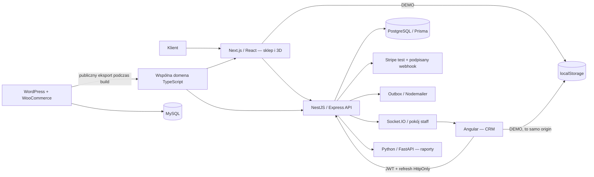

Projekt koncepcyjny do portfolio – fikcyjna marka

# Nordhaus Studio

**Jedna platforma od inspiracji do obsługi projektu.** Sklep headless, parametryczny konfigurator pergoli 3D, rezerwacje i CRM — połączone wspólną domeną i API.

Autor: **Andrii Tsap** · [GitHub](https://github.com/andriu-tsap)

**[▶ Demo na żywo](https://andriu-tsap.github.io/nordhaus-studio/)** · [Konfigurator 3D](https://andriu-tsap.github.io/nordhaus-studio/configure/) · [CRM (demo / demo123)](https://andriu-tsap.github.io/nordhaus-studio/studio/) · [Sklep](https://andriu-tsap.github.io/nordhaus-studio/shop/)

> Fikcyjne produkty, ceny, osoby i projekty. Brak opinii klientów i deklaracji wyników biznesowych. Wszystkie płatności wyłącznie testowe. W demo używaj fikcyjnych danych. Login CRM: **demo / demo123** — dotyczy tylko przeglądarkowego mocka, nigdy API.

## Problem → rozwiązanie

Firma projektująca wnętrza i tarasy potrzebuje spójnego procesu: klient znajduje produkt, dopasowuje pergolę, otrzymuje orientacyjną wycenę i rezerwuje konsultację. Zespół ma wszystkie zapytania w jednym lejku zamiast w kilku skrzynkach pocztowych.

Nordhaus łączy te etapy. Wycena i walidacja korzystają z tego samego pakietu domenowego. API zawsze ponownie liczy koszyk, a unikalny indeks SQL chroni termin przed dwoma równoczesnymi zapisami. Tryb DEMO pozwala obejrzeć cały interfejs bez kont serwerowych.

## Funkcje

| Obszar          | Działające funkcje                                                                                                                                                                                                                        |
| --------------- | ----------------------------------------------------------------------------------------------------------------------------------------------------------------------------------------------------------------------------------------- |
| Witryna i sklep | Next.js App Router, SSG, katalog, wyszukiwarka, kategorie, limit ceny, sortowanie, warianty, zbliżenie zdjęcia, koszyk, checkout DEMO / testowy Stripe                                                                                    |
| Treści          | WordPress + WooCommerce, własna wtyczka, CPT przestrzeni/FAQ/zespołu, pola REST, seed produktów z wariantami, eksport CMS w czasie budowania, artykuły i koncepcje                                                                        |
| Konfigurator    | React Three Fiber, parametry szerokości/wysięgu/wysokości, 3 dachy, animowane lamele, 3 kolory RAL, LED, roleta, dzień/noc, dotyk i zoom, opcjonalny GLB, PDF z widokiem 3D                                                               |
| Rezerwacje      | Strefa Europe/Warsaw z DST, godzina na konsultację, dwie osoby, przerwa 12–13, brak weekendów, ochrona przed podwójną rezerwacją w PostgreSQL                                                                                             |
| CRM             | Angular standalone + signals, lazy routes, guard, interceptor, formularze reaktywne, Kanban CDK drag & drop oraz wybór etapu klawiaturą, historia klienta, kalendarz, CSV, PDF oferty i faktury DEMO, cennik administratora, ciemny motyw |
| API             | NestJS na Express, Prisma + PostgreSQL, JWT 15 min, rotowane tokeny odświeżania w HttpOnly cookie, role, Swagger, DTO, Helmet, throttling, sprawdzanie Origin, podpisany webhook Stripe                                                   |
| Operacje        | Nodemailer + trwały outbox i 3 próby, Socket.IO dla pracowników, wewnętrzna analityka Python/FastAPI, Docker Compose, GitHub Actions, pliki Render/Railway                                                                                |
| Jakość          | TypeScript, ESLint, Prettier, Vitest, testy API z prawdziwą bazą, pytest, Playwright desktop/mobile, Lighthouse, semantyczny HTML, sitemap/robots, Product/Organization JSON-LD                                                           |

Interfejs sklepu ma przełącznik PL/EN dla nawigacji, strony głównej i najważniejszych akcji. Katalog redakcyjny, poradniki, formularze szczegółowe oraz CRM są po polsku. Nie deklarujemy pełnego tłumaczenia treści CMS.

## Architektura



```text
apps/storefront/   Next.js, React, Three.js, Zustand, CSS
apps/studio/       Angular, CDK, signals, lazy routes
apps/api/          NestJS, DTO, auth, Prisma, PDF, mail, events
packages/domain/   Ceny w groszach, walidacja, sloty, CSV, dane CMS
services/insights/ Python: agregacje i testy
wordpress/         Wtyczka, inicjalizacja, Playground blueprint
infra/             Nginx, Render, Railway, API Dockerfile
scripts/           CMS sync, pakowanie, inicjalizacja środowiska, Lighthouse
screenshots/       Zrzuty desktop i mobile z Playwright
reports/           Rzeczywiste raporty jakości i Lighthouse
```

## Technologie i decyzje

Next.js 16 / React 19, Angular 21, NestJS 11, TypeScript 5.9, Node 24, Three.js, React Three Fiber, drei, Zustand, Angular CDK, Prisma 6, PostgreSQL 17, WordPress/PHP 8.3, WooCommerce, MySQL 8.4, Python 3.12 i FastAPI. Wersje zależności JavaScript są zablokowane w `package-lock.json`.

Celowo jedna baza biznesowa PostgreSQL i jeden backend zamiast dwóch rozbieżnych systemów rezerwacji i ofert. Czysty CSS służy kontroli projektu wizualnego; osobna strona `public/pergola.html` to semantyczny HTML/CSS z osadzonym konfiguratorem. SSG umożliwia GitHub Pages; ISR wymaga serwerowej konfiguracji Next.js i nie jest częścią statycznego eksportu.

## Uruchomienie lokalne — Docker

Wymagania: Docker Engine + Compose v2, Python 3 do wygenerowania lokalnych sekretów, około 4 GB RAM. Porty: 8088, 4000, 8080, 8025, 5432.

```bash
python scripts/init-env.py
docker compose up --build -d
```

Pierwsza komenda tworzy ignorowany `.env` z losowymi hasłami. Nie nadpisuje istniejącego pliku. Cały system uruchamia druga komenda. Pierwsze pobranie WordPress/WooCommerce i budowa frontendów może potrwać kilka minut.

- Sklep, konfigurator i CRM: http://localhost:8088/ oraz `/studio/`.
- API / dokumentacja: http://localhost:4000/docs.
- WordPress: http://localhost:8080/wp-admin/ — dane z `WP_ADMIN_USER` i `WP_ADMIN_PASSWORD` w `.env`.
- Podgląd wiadomości: http://localhost:8025/ — Mailpit, wiadomości nie wychodzą do internetu.
- Logi inicjalizacji CMS: `docker compose logs wp-init`.

Domyślnie frontend jest w DEMO. Aby korzystać z API, ustaw w `.env` **oba** pola `NEXT_PUBLIC_API_URL=http://localhost:4000` oraz `STUDIO_API_URL=http://localhost:4000`, potem `docker compose up --build -d`. Login API to `SEED_ADMIN_EMAIL` i wygenerowane `SEED_ADMIN_PASSWORD`. Konto demo/demo123 nie działa w API.

Zmienne `NEXT_PUBLIC_*` i `STUDIO_API_URL` są publiczną konfiguracją frontendów — nigdy nie umieszczaj tam sekretów. Sekrety należą wyłącznie do środowiska backendu.

## Uruchomienie developerskie bez kontenerów frontendów

```bash
npm ci
python scripts/init-env.py
# DATABASE_URL w .env wskazuje lokalny PostgreSQL; Compose używa automatycznie nazwy postgres.
docker compose up -d postgres mailpit insights
npm run db:push
npm run db:seed
npm run build -w @nordhaus/domain
npm run dev
```

Skrypt `dev` backendu wczytuje główny `.env`. Alternatywnie uruchom skompilowany backend:

```bash
npm run build -w @nordhaus/api
cd apps/api
node --env-file=../../.env dist/main.js
```

Dla lokalnego backendu ustaw `SMTP_HOST=localhost` i `SMTP_PORT=1025` oraz `INSIGHTS_URL=http://localhost:8001`. Compose nie publikuje domyślnie portów wewnętrznych SMTP/insights; użyj pełnego backendu Compose albo uruchom usługi bezpośrednio z odpowiednimi portami. Do samych frontendów wystarczą `npm run dev -w @nordhaus/storefront` i `npm run dev -w @nordhaus/studio`.

Samodzielny pakiet DEMO:

```bash
npm ci
npm run demo:build
npx http-server dist -p 4173 -c-1
```

Otwórz http://localhost:4173/. **Nie otwieraj index.html przez file://** — moduły, font PDF i podstrony wymagają HTTP.

## CMS i WordPress Playground

Po inicjalizacji CMS można zmieniać produkty, warianty i treści przez panel WordPress:

```bash
WORDPRESS_URL=http://localhost:8080 npm run cms:sync
npm run demo:build
```

Eksport zapisuje wyłącznie opublikowane treści publiczne do `packages/domain/src/cms.ts`. Pusty eksport artykułów pozostawia lokalny katalog poradników. Po zmianie CMS wykonaj przebudowę i frontendów, i API, aby ceny były spójne. Checkout korzysta ze wspólnego katalogu domeny; nie tworzy zamówień WooCommerce. WooCommerce pełni funkcję headless CMS.

Blueprint `wordpress/blueprint.json` instaluje WordPress, WooCommerce i własną wtyczkę. Kod wtyczki jest osadzony w blueprint, więc nie wymaga dostępu do prywatnego hostingu Sites. Wtyczka jest dostępna w statycznym demo jako `/nordhaus-studio-plugin.zip`. Otwórz https://playground.wordpress.net/ i zaimportuj blueprint; wymaga dostępu sieciowego. Przycisk seed jest też w Narzędzia → Nordhaus demo. Instalacja jest idempotentna.

## Testy i jakość

```bash
npm run lint
npm run build
npm test
python -m pip install -r services/insights/requirements.txt
python -m pytest services/insights -q
npm run demo:build
npx playwright install chromium
npm run test:e2e
```

Testy API wymagają uruchomionego API z bazą testową oraz `API_TEST_URL` i danych administratora w środowisku. Bez `API_TEST_URL` są jawnie pomijane. Używaj osobnej bazy testowej: test równoczesnych rezerwacji zapisuje termin 2030-11-18 i przy ponownym uruchomieniu należy wyczyścić bazę testową.

```bash
API_TEST_URL=http://localhost:4000 node --env-file=.env node_modules/vitest/vitest.mjs run
```

GitHub Actions uruchamia lint/format, kompilację wszystkich aplikacji, testy domeny i API na PostgreSQL, pytest, Playwright na desktopie i mobile, Lighthouse na stronie głównej oraz deployment Pages po sukcesie. Lighthouse wymaga Chrome i serwera statycznego; raporty JSON będą artefaktem `quality-reports` po uruchomieniu workflow na GitHub. Zweryfikowany wynik strony głównej: mobile **92 / 100 / 100 / 100**, desktop **100 / 100 / 100 / 100** (performance / accessibility / best practices / SEO). Wyniki nie są obietnicą identycznych pomiarów na każdym urządzeniu. Zmierzono również lokalnie przez zestaw Playwright w systemowym Chromium. Szczegóły pomiarów i zakres w [reports/VERIFICATION.md](reports/VERIFICATION.md).

## Deployment


**GitHub Pages**: demo jest publikowane z gałęzi `gh-pages` (statyczny eksport Next.js z `basePath=/nordhaus-studio` + Angular CRM w `/studio/`). Zbudowanie: `NEXT_PUBLIC_BASE_PATH=/nordhaus-studio npm run build && node scripts/package-demo.mjs`, a następnie publikacja katalogu `dist/`. Deep linki Next mają końcowy slash, CRM używa routingu hash. DEMO działa bez backendu.

**Vercel**: aplikacja statyczna, root monorepo, komenda `npm run build -w @nordhaus/domain && npm run build -w @nordhaus/storefront`, output `apps/storefront/out`; usuń `NEXT_PUBLIC_BASE_PATH` dla domeny głównej. CRM opublikuj pod `/studio/` przez zbiorczy build, jeśli ma współdzielić demo.

**Render**: utwórz PostgreSQL i usługę z `infra/Dockerfile.api`; opcjonalny blueprint w `infra/render.yaml`. Skopiuj wymagane zmienne z `.env.example`, ustaw unikalny JWT_SECRET (≥32 znaki) i hasło seed (≥12). CORS musi zawierać samo origin, np. `https://andriu-tsap.github.io`; FRONTEND_URL zawiera też `/nordhaus-studio`. Ustaw SMTP i usługę insights. HTTPS jest wymagane dla bezpiecznych refresh cookie w produkcji. Plan bezpłatny i retencja bazy zależą od aktualnej oferty dostawcy; projekt nie zakłada wieczystego darmowego hostingu bazy.

**Railway**: PostgreSQL + API z `infra/railway.json`, te same zmienne. Usługa Python ma osobny Dockerfile w `services/insights`. Wspólny INSIGHTS_KEY łączy tylko API i usługę Python. Nie umieszczaj go we frontendzie.

**Stripe**: tylko `sk_test_…`, webhook `POST /stripe/webhook`, zdarzenie `checkout.session.completed`. Lokalnie użyj Stripe CLI do przekazywania webhooków i ustaw jego `whsec_…`. Stan płatności w bazie zmienia wyłącznie zweryfikowany webhook, nie adres przekierowania przeglądarki. W DEMO nie używamy żadnego klucza ani danych karty.

## Bezpieczeństwo i granice wdrożenia

To działająca aplikacja referencyjna do portfolio, z zabezpieczeniami backendu i działającym DEMO. Przed obsługą prawdziwych klientów należy skonfigurować domeny, dostawcę poczty, kopie zapasowe, politykę danych i monitoring. Mail outbox zakłada **jedną instancję API**; wiele replik wymaga leasingu rekordów lub osobnego brokera. Wiadomości po trzeciej nieudanej próbie wymagają interwencji operatora.

Wersjonowanie schematu znajduje się w Prisma. `db push` jest wygodne do demo; dla produkcji przygotuj i zatwierdź migrację `prisma migrate dev`, a przy wdrożeniu stosuj `prisma migrate deploy`. PDF faktury jest jednoznacznie demonstracyjny, bez skutków księgowych. GLB to opcjonalny detal; konstrukcja pergoli jest generowana parametrycznie, bez zależności od zewnętrznego serwisu 3D.

Automatyczne pomiary dostępności nie zastępują audytu WCAG. Przygotowano widoczny focus, etykiety formularzy, skip link, reduced motion, kontrast, obsługę klawiaturą Kanban oraz odpowiednik konfigurowania w kontrolkach formularza. Warstwa 3D nie jest jedynym sposobem wyboru parametrów.

## Demo i zrzuty

| Projekt         | Repo                                                                   | Demo                                                                   | Stack                                           | Lighthouse                                                       | Start                                                         |
| --------------- | ---------------------------------------------------------------------- | ---------------------------------------------------------------------- | ----------------------------------------------- | ---------------------------------------------------------------- | ------------------------------------------------------------- |
| Nordhaus Studio | GitHub: andriu-tsap/nordhaus-studio | [Pages](https://andriu-tsap.github.io/nordhaus-studio/) | Next/React, Angular, Nest/Node, WP, Python, SQL | 92 / 100 (mobile / desktop), pozostałe 100; raporty w `/reports` | `python scripts/init-env.py` → `docker compose up --build -d` |

Zrzuty: `screenshots/home-desktop.png`, `home-mobile.png`, `configurator-desktop.png`, `configurator-mobile.png`, `crm-desktop.png`, `crm-mobile.png`. Utworzone lokalnie przez Playwright; pipeline może je odtworzyć. Źródła zdjęć i fontu: [ASSETS.md](ASSETS.md). Licencja kodu: MIT.
